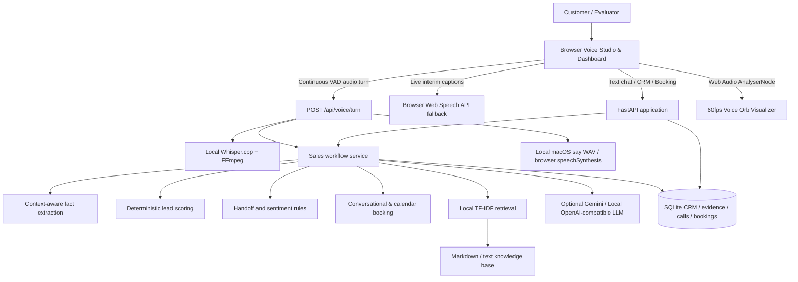

# SalesPilot AI — Architecture

## Current MVP architecture

## Core design decisions

1. **Model output is not business authority.** The scoring rubric, appointment conflict checks, CRM writes, and handoff state are controlled deterministically by backend Python logic.
2. **Evidence is first-class data.** Every extracted field is stored with its transcript quote, field name, status, and confidence. The UI displays this relationship in the Evidence Ledger. An optional local model may supplement rule-based extraction only when it supplies a verbatim quote present in the customer message.
3. **Unknown is a valid answer.** Retrieval returns source passages from `knowledge_base/`. If there is no sufficient lexical match, the agent declines to guess and flags a human follow-up.
4. **Local-first continuous voice pipeline.** Continuous browser Voice Activity Detection (VAD) pairs with single-roundtrip `/api/voice/turn` (Whisper.cpp STT -> Agent -> macOS `say` WAV TTS) so audio stays on the machine with minimal turnaround latency. Browser Web Speech API and `speechSynthesis` act as zero-config fallbacks when local binaries are absent.
5. **Provider boundaries are explicit.** Speech recognition, speech synthesis, and LLM adapters (Gemini REST API / local OpenAI-compatible server) live in isolated modules (`voice.py`, `local_llm.py`) and are not required for CRM, booking, or scoring tests.

## Data flow

1. A sales user selects or creates a lead (clicking a Lead Pipeline row or dropdown automatically loads their latest call transcript).
2. Clicking **Start Live Call** opens an echo-cancelled microphone stream once and runs a continuous VAD turn-taking loop (or the user types into the composer).
3. Customer audio is transcribed via Whisper.cpp (or browser SpeechRecognition), and `agent.py` checks conversational context (prior agent prompt) to extract requirement, budget, timeline, and decision-maker facts.
4. Each explicitly extracted field is written to `evidence` with the exact customer quote.
5. `scoring.py` computes the deterministic 0–100 score and hot/warm/cold status from stored fields.
6. Booking requests check real SQLite availability (`Asia/Kolkata` weekday slots) with overlap checks and idempotency keys; product questions query `knowledge.py` TF-IDF chunks and cite sources or trigger human handoff.
7. `voice.py` cleans markdown/symbols (`format_for_speech`) and synthesizes WAV audio played through Web Audio API to drive the reactive Voice Orb, then immediately loops back to listening.

## Evidence Ledger schema

`evidence` has a unique `(lead_id, field)` constraint for the latest verified value per field. Each record includes `value`, `quote`, `status`, `confidence`, `call_id`, and `created_at`. The MVP stores the latest evidence per field rather than a complete immutable event history. A production implementation should add append-only evidence events and corrections/retractions instead of overwriting a prior fact.

## Production extension points

- Replace lexical retrieval with multilingual embeddings and a vector store (`pgvector` or another managed/self-hosted vector database).
- Replace regex/rule extraction with schema-constrained structured LLM extraction plus deterministic validation.
- Use WebRTC/SIP and a streaming voice pipeline (LiveKit Agents or Pipecat) for sub-200ms full-duplex telephony calls.
- Move long-running summaries and CRM sync into a durable task queue.
- Use PostgreSQL, tenant isolation, authentication, RBAC, secrets management, and audit logging.
