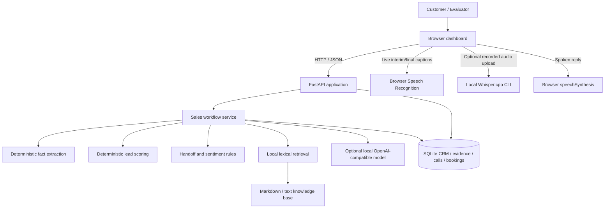

# SalesPilot AI — Architecture

## Current MVP architecture

## Core design decisions

1. **Model output is not business authority.** The scoring rubric, appointment conflict checks, CRM writes, and handoff state are controlled by backend logic.
2. **Evidence is first-class data.** An extracted field is stored with its transcript quote, field name, status, and confidence. The UI displays this relationship. An optional local model may supplement rule-based extraction, but a model-derived field is accepted only when it includes a verbatim quote found in the customer message.
3. **Unknown is a valid answer.** Retrieval returns source passages. If there is no sufficient lexical match, the agent escalates rather than synthesizing unsupported product claims.
4. **Cost-aware voice modes.** Live browser recognition and browser TTS give the demo a zero-marginal-cost voice path for SalesPilot; local Whisper.cpp is the privacy-oriented fallback. Browser recognition is not claimed to be local because its processing depends on browser/vendor settings.
5. **Provider boundaries are explicit.** Speech recognition, speech synthesis and local LLM are replaceable services; they are not required for CRM and scoring tests.

## Data flow

1. A sales user creates or selects a lead.
2. A conversation session is created and customer messages are stored.
3. The extractor identifies supported fields in the customer message.
4. Each explicitly extracted field is written to `evidence` with the exact message text as its evidence quote.
5. The scoring service calculates points from stored, explicit fields.
6. For product questions, the knowledge service ranks local chunks using token frequency and inverse document frequency.
7. The agent uses a retrieved source or escalates if no relevant source exists.
8. Appointment booking checks for time overlap and supports idempotency keys.

## Evidence Ledger schema

`evidence` has a unique `(lead_id, field)` constraint for the latest verified value per field. Each record includes `value`, `quote`, `status`, `confidence`, `call_id`, and `created_at`. The MVP stores the latest evidence per field rather than a complete immutable event history. A production implementation should add append-only evidence events and corrections/retractions instead of overwriting a prior fact.

## Production extension points

- Replace lexical retrieval with multilingual embeddings and a vector store (pgvector or another managed/self-hosted vector database).
- Replace regex extraction with schema-constrained structured LLM extraction plus deterministic validation.
- Use WebRTC/SIP and a streaming voice pipeline (LiveKit Agents or Pipecat) for real-time full-duplex calls.
- Move long-running summaries and CRM sync into a durable task queue.
- Use PostgreSQL, tenant isolation, authentication, RBAC, secrets management and audit logging.
