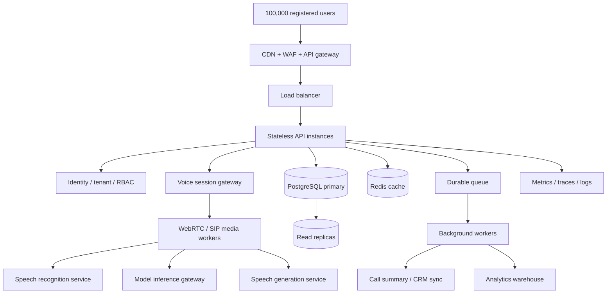

# Scalability plan — target architecture for 100,000 registered users

The current SQLite/local MVP is not load-tested or designed for 100,000 concurrent users. The assignment's 100,000-user figure must be translated into an explicit workload model.

## Workload dimensions to clarify

- Registered users versus monthly active users.
- Calls per active user per month.
- Average call duration and audio bitrate.
- Peak concurrent voice sessions.
- Transcript retention and query volume.
- Geographic distribution, language mix and availability SLO.

Illustrative planning scenario (not a measured result): 100,000 registered users × 10 calls per month × 3 minutes per call = 3,000,000 voice minutes per month. A separate concurrency calculation is required; 100,000 registered users do not imply 100,000 simultaneous calls.

## Proposed production architecture

## Scale-out strategy

- Stateless API processes behind a load balancer; horizontal autoscaling based on CPU, memory, request rate and latency.
- Isolate real-time media workers from CRUD APIs and background summary workers.
- Use an inference gateway to manage model routing, quotas, batching, GPU pools and backpressure.
- PostgreSQL with connection pooling, indexes, tenant-aware access policies, read replicas and partitioning when data volume justifies it.
- Redis for short-lived session state and hot metadata; never use cache as the only durable record of an appointment or evidence event.
- Durable queue for summaries, analytics, CRM synchronization, retries and dead-letter handling.
- Object storage for optional encrypted audio files; use short retention and access auditing.
- Rate limits and per-tenant quotas to stop one tenant from exhausting model or telephony capacity.
- Observability for speech latency, first-token latency, turn-taking, transcription quality, tool failures, handoff rates, booking conflicts, cost per call and conversion.

## Reliability controls

- Idempotency keys for bookings and CRM writes.
- Retries with exponential backoff for transient provider failures.
- Dead-letter queue and operator replay for failed asynchronous jobs.
- Circuit breakers and human fallback when model or telephony providers degrade.
- Multi-zone database backups and tested restoration procedures.
- Load testing against a defined concurrent-call target before publishing a capacity claim.

## Cost model

Monthly operating cost should be modeled as:

`voice minutes × STT rate + model tokens/minutes + TTS characters/minutes + telephony minutes + compute + database/storage + monitoring + support`.

## Cost-control strategy

- Use voice activity detection and endpointing so silence is never transcribed or sent to a model.
- Stream only final speech turns to the sales workflow; use small local/rule-based extraction for qualification and reserve an LLM for grounded, complex questions.
- Cache repeated FAQ answers and pre-generate common TTS prompts. Keep responses concise to reduce generated audio.
- Tier routing: browser/local speech for development and internal demos; a measured managed STT/TTS provider for production quality; a self-hosted pool only after sustained volume justifies GPU operations.
- Store transcripts by default and make audio retention opt-in with a short lifecycle. Audio storage and egress often grow unnoticed.

A local model can reduce third-party inference charges, but production GPU/CPU, power, redundancy, networking, maintenance and staffing are not free. Provide an estimate only after the target concurrency and quality requirements are known.
